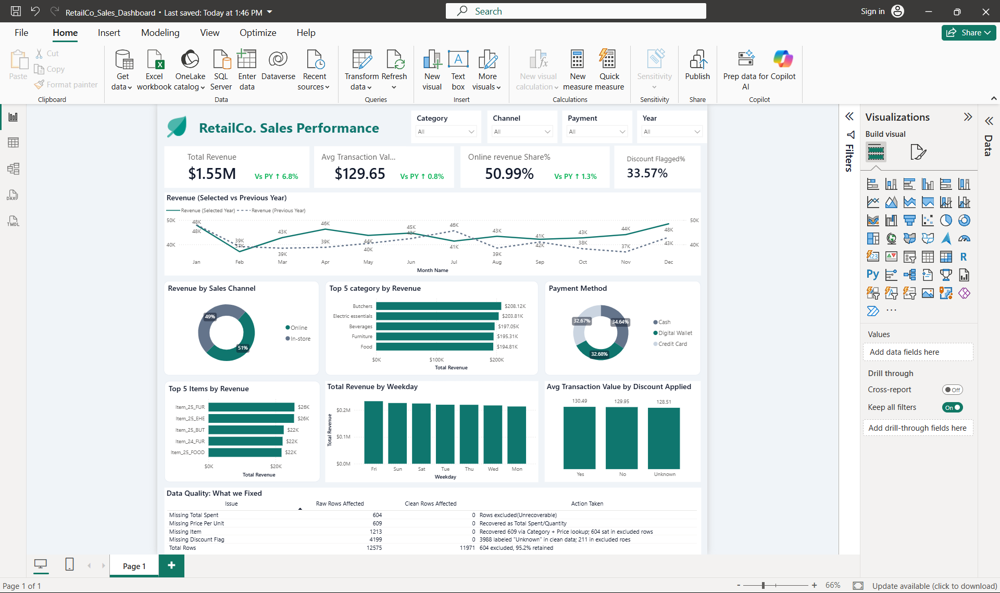

# RetailCo Sales Performance Dashboard

An end-to-end Power BI project that cleans a deliberately messy retail dataset, audits its data quality, and turns it into a one-page sales performance dashboard.



> **Note:** "RetailCo" is a fictional company name used for presentation. The data is a sample retail dataset.

## 📌 Project Overview

**$1.55M in revenue came from 11,971 transactions. But only 95.2% of the raw data was usable.**

The raw file had missing prices, quantities, items and discount flags. Before any analysis, each issue had to be investigated, recovered where it was safe to do so, and excluded where it was not. The cleaned data was then used to look at **revenue trends, sales channels, categories, items, payment methods, weekdays and the effect of discounts**.

This project covers **12,575 raw transaction records** (2022-01-01 to 2025-01-18) and answers these questions:

- How much revenue are we generating, and how is it trending year over year?
- Which sales channels, categories, items and payment methods drive revenue?
- Which days of the week perform best?
- Do discounts change how much customers spend?
- How trustworthy is the underlying data?

**Total revenue: $1,552,071** | **Transactions: 11,971** | **Average transaction value: $129.65**

## 🧰 Tools & Tech Stack

- **Power BI Desktop**: interactive one-page dashboard
- **Power Query (M)**: data cleaning and transformation
- **DAX**: measures for revenue, growth, share and discount rate
- **Data model**: `Sales`, `Calendar_Table` and a `DQ_Audit` table

## 📂 Repository Structure

```
├── dashboard/
│   ├── RetailCo_Sales_Dashboard.pbix     # Power BI dashboard (source file)
│   └── RetailCo_Sales_Dashboard.pdf      # PDF export
├── data/
│   ├── retail_store_sales.csv            # Raw dataset
│   └── data_dictionary.md                # Column definitions and checks
├── docs/
│   ├── data_cleaning.md                  # Cleaning rules and audit table
│   └── dax_measures.md                   # DAX measures
├── images/
│   └── dashboard.png                     # Dashboard screenshot
└── README.md
```

## 🧹 Data Cleaning

The raw file has 12,575 rows. **11,971 (95.2%)** were kept after cleaning.

| Issue | Raw rows | Action |
|---|---|---|
| Missing Total Spent | 604 | Excluded (unrecoverable, Quantity also missing) |
| Missing Price Per Unit | 609 | Recovered as Total Spent / Quantity |
| Missing Item | 1,213 | 609 recovered via Category + Price lookup; 604 were in excluded rows |
| Missing Discount Flag | 4,199 | 3,988 labelled "Unknown" in clean data; 211 in excluded rows |

**Why the recoveries are safe:**
- `Price Per Unit x Quantity = Total Spent` on 100% of complete rows.
- Every Category + Price Per Unit pair maps to exactly one item, so there is no ambiguity when recovering items.

Full details: [docs/data_cleaning.md](docs/data_cleaning.md)

## 🔍 Key Insights

| Finding | Detail |
|---|---|
| **Revenue growth** | 2024 revenue ($524.9K) was **+6.8%** vs 2023 ($491.3K). |
| **Channels are balanced** | Online 51% / In-store 49% of revenue. |
| **Categories are evenly spread** | Butchers leads at $208.1K; Milk Products is lowest at $180.1K, a gap of about 15%. |
| **Friday is the strongest day** | $232.8K, versus $213.1K on Monday (the weakest). |
| **Top items** | Item_25_FUR ($25.3K) and Item_25_EHE ($23.1K) lead the item ranking. |
| **Payment mix is even** | Cash 34.6%, Credit Card 32.7%, Digital Wallet 32.7% of revenue. |
| **Discounts show no measurable effect** | Average basket is $130.49 (discounted), $129.95 (not discounted) and $128.51 (unknown). `Total Spent` always equals price x quantity, so the discount flag is not reflected in the amount. |

## ✅ Recommendations

1. **Review the discount strategy.** The discount flag shows no measurable lift in basket value, so test whether discounts are earning their cost.
2. **Fix discount tracking at the source.** 33% of clean rows have an unknown flag, which limits any discount analysis.
3. **Plan around Friday.** It is the strongest revenue day, so staffing and promotions should reflect that.
4. **Strengthen data capture.** Missing prices, quantities and items cost 4.8% of rows. Validation at the point of sale would prevent most of it.

## 📊 Dashboard Preview

**Filters:** Category, Channel, Payment, Year

**KPI cards**
1. Total Revenue
2. Online Revenue Share %
3. Average Transaction Value
4. Discount Flagged %

**Charts**
1. Revenue: Selected vs Previous Year (monthly)
2. Revenue by Sales Channel
3. Top 5 Categories by Revenue
4. Payment Method
5. Top 5 Items by Revenue
6. Total Revenue by Weekday
7. Average Transaction Value by Discount Applied
8. Data Quality: What We Fixed (audit table)

## ⚠️ Limitations

- 2025 contains only 18 days (to 2025-01-18), so year comparisons involving 2025 are not meaningful.
- 604 rows (4.8%) were excluded and could not be estimated.
- 33% of clean rows have an unknown discount flag, so discount analysis is indicative only.

## 🚀 How to Explore This Project

1. Clone or download the repo.
2. Read [docs/data_cleaning.md](docs/data_cleaning.md) for the cleaning logic and [docs/dax_measures.md](docs/dax_measures.md) for the measures.
3. Install [Power BI Desktop](https://powerbi.microsoft.com/desktop/) (free, Windows) and open `dashboard/RetailCo_Sales_Dashboard.pbix`. If prompted, point the data source to `data/retail_store_sales.csv`.
4. Or view the PDF export or the screenshot directly.

## 📁 Dataset Source

Retail Store Sales: Dirty for Data Cleaning (Kaggle)
https://www.kaggle.com/datasets/ahmedmohamed2003/retail-store-sales-dirty-for-data-cleaning

Please check the license on the Kaggle page before reuse. The project includes the raw dataset; the cleaning is documented in `docs/data_cleaning.md`.

## 👤 Author

**Mohit Chaudhary**

Data Analytics |Power Query| Power BI

*Feel free to open an issue or reach out if you have questions or suggestions!*
